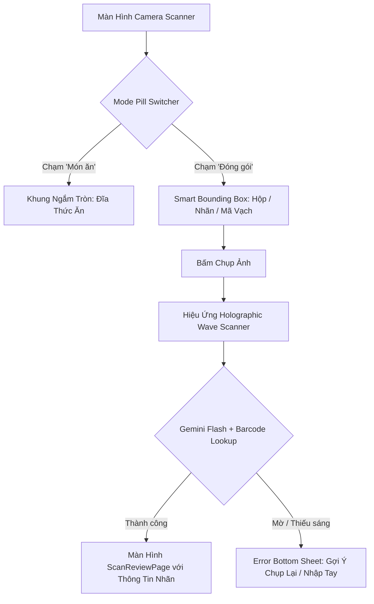

# UI/UX Design Specification: Barcode & Nutrition Label OCR Scanner

- **Mã tính năng**: `FEAT-S32-BARCODE-OCR`
- **Tác giả**: Sub-Agent UI/UX Designer (*The Celestial Aesthetic Purist*)
- **Thẩm định & Ký duyệt**: Sub-Agent BA (*The Pedantic Logician*), PO & Tech Lead
- **Trạng thái**: 🟢 **APPROVED (Gate 2 Sign-Off)**

---

## 1. Sơ Đồ Điều Hướng & Luồng Tương Tác Người Dùng (Mermaid User Flow)

---

## 2. Layout Blueprint (Hệ Thống Lưới 4pt Chuẩn Công Thái Học)

### A. Thanh Chọn Chế Độ Quét (Scanner Mode Pill Switcher)
- **Vị trí**: Đặt chính giữa, cách nút chụp ảnh `24pt` về phía trên (thuộc Thumb Zone, 1 tay thao tác dễ dàng).
- **Kích thước**: Chiều cao `40pt`, bo góc `20pt` dạng viên con nhộng (Pill).
- **Background**: Kính mờ `AppColors.surfaceContainer` mờ 60% với `BackdropFilter` (blur 12pt).
- **Tab được chọn**: Nền trắng tinh khiết (`#FFFFFF`), đổ bóng nhẹ `Offset(0, 2), blur 4, color: Colors.black12`, chữ đậm `AppColors.primary` (`#1CB0F6`).
- **Tab không chọn**: Chữ mờ `AppColors.onSurfaceVariant` (`#78829A`).

### B. Khung Ngắm Nhãn Dinh Dưỡng Thông Minh (Smart Bounding Box Viewfinder)
- **Kích thước khung**: Tỷ lệ 3:4 hoặc 4:5, chiếm 75% chiều rộng màn hình, bo 4 góc `24pt`.
- **Hiệu ứng viền**: 4 góc ngắm nổi bật bằng nét vẽ đậm `3.5pt` màu Primary Sky Blue (`#1CB0F6`), có hiệu ứng nhịp thở nhẹ nhàng (Breathing pulse).
- **Dải chỉ dẫn (Guidance Pill)**:
  - Nền đen mờ 50% bo góc `16pt`, chữ trắng `13pt` Regular.
  - Nội dung: *"Căn bảng dinh dưỡng hoặc mã vạch vào khung"* / *"Align nutrition table or barcode within frame"*.

---

## 3. Ma Trận 5 Trạng Thái Giao Diện Bắt Buộc (The 5 Core UI States)

| Trạng Thái | Mô Tả Giao Diện | Màu Sắc & Tokens | Tương Tác & Phản Hồi |
| :--- | :--- | :--- | :--- |
| **1. Default** | Khung ngắm chữ nhật thông minh sáng rõ nét, 4 góc bo `24pt` xanh Sky Blue, Mode Pill "Đóng gói" active. | `AppColors.primary` (`#1CB0F6`), nền camera trong suốt. | Chạm để lấy nét (Tap to focus) với vòng sóng tròn. |
| **2. Scanning / Shimmer** | Dải sáng quét Holographic di chuyển quét lên xuống qua khung ngắm. | Gradient `#1CB0F6` ➔ `#58CC02` mờ dần. | Vô hiệu hóa nút chụp, hiển thị text: *"Đang giải mã nhãn dinh dưỡng..."*. |
| **3. Review / Success** | Tự động mở `ScanReviewPage` với Hero Card nhãn sản phẩm, Macro Gauges và Serving Size. | Carbs `#1CB0F6`, Fat `#FF5C8D`, Protein `#FF9600`. | Slider điều chỉnh gram hoặc số khẩu phần ăn. |
| **4. Error / Unreadable** | Popup Clay Sheet mềm mại báo không đọc được nhãn hoặc ảnh bị lóa sáng. | Biểu tượng cảnh báo vàng cam `AppColors.tertiary`, nút "Chụp lại" 3D Duolingo. | Chạm "Thử lại" hoặc "Nhập thủ công". |
| **5. Offline Mode** | Banner nhỏ thông báo: *"Đang ngoại tuyến. Mã vạch sẽ được lưu đệm và phân tích khi có mạng"*. | Nền `clayLunch` (`#E5F6FD`), chữ `AppColors.onSurface`. | Lưu ảnh vào local queue nếu không có mạng. |

---

## 4. Chữ Ký Phê Duyệt Gate 2 (Design Sign-Off)
- **Sub-Agent UI/UX Designer**: 🟢 **SIGNED (Celestial Ergonomic Spec Complete)**
- **Sub-Agent BA**: 🟢 **TRACEABILITY VERIFIED (100% User Stories Covered)**
- **Sub-Agent Tech Lead**: 🟢 **FEASIBILITY APPROVED (Zero Layout Overhead)**
