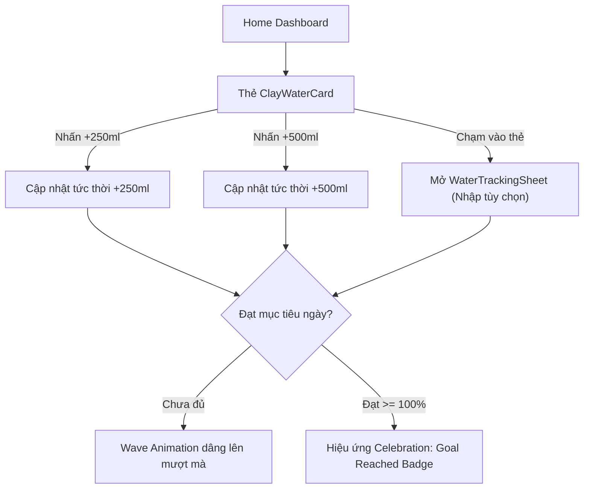

# UI/UX Specification: Claymorphic Water Intake Tracker (Sprint 33)

> **Sub-Agent**: UI/UX Designer (`ui-ux-designer`) — *"The Celestial Aesthetic Purist"*  
> **Gate**: Gate 2 (UI Flow, 4pt Layout Blueprint & 5 UI States)  
> **Feature**: `FEAT-S33-WATER-TRACKER` | **Version**: `v3.5.0`  
> **Status**: ✅ **DESIGN SIGN-OFF APPROVED**

---

## 1. User Interaction Flow (Mermaid)



---

## 2. Design Tokens & Styling (Claymorphic × Duolingo 3D)

- **Color Semantics**:
  - 💧 **Water Primary**: `#1CB0F6` (Duolingo Sky Blue — màu chất lỏng, carbs & hydrat hóa).
  - 🌊 **Wave Gradient**: `LinearGradient(from: #1CB0F6, to: #0088CC)`.
  - 🥛 **Surface Canvas**: `#FAF8F5` (Warm Milk Canvas).
  - 🪨 **Card Surface**: `#FFFFFF` với corner radius `20pt`.
  - 🎯 **Goal Achieved Green**: `#58CC02` (Duolingo Lime Green — năng lượng & hoàn thành).
- **Claymorphic Shadows**:
  - `BoxShadow(offset: Offset(0, 8), blurRadius: 16, color: Color(0x12000000))`
  - `BoxShadow(offset: Offset(0, 3.5), blurRadius: 0, color: Color(0x181CB0F6))`
- **Tactile Squash**:
  - Thu nhỏ `0.98` scale khi chạm và haptic feedback nhẹ.

---

## 3. Screen Layout Blueprint (4pt Grid)

```
┌────────────────────────────────────────────────────────┐
│  💧 Nước Uống Hôm Nay                       2000 ml 🎯 │ (padding: 16pt)
├────────────────────────────────────────────────────────┤
│  ┌─────────────────────────┐  ┌──────────────────────┐ │
│  │     🌊 Làn Sóng Nước    │  │ 1250 / 2000 ml       │ │ (h: 96pt)
│  │   Animated 60 FPS Wave  │  │ 62.5% Hoàn thành     │ │
│  │        [ 62.5% ]        │  │ Còn 750 ml           │ │
│  └─────────────────────────┘  └──────────────────────┘ │
├────────────────────────────────────────────────────────┤
│  [ +250 ml (Ly) ]       [ +500 ml (Chai) ]    [ Tùy chọn ]│ (gap: 12pt, h: 44pt)
└────────────────────────────────────────────────────────┘
```

---

## 4. 5 UI States Specification

1. **Default State**: Hiển thị mức nước hiện tại kèm animation sóng nhẹ nhàng.
2. **Active Logging State**: Sóng nước dâng lên với đường cong bezier động (`Curves.easeOutCubic`, 400ms).
3. **Quick Log Bottom Sheet**: Sheet trượt lên từ đáy màn hình để nhập số ml tùy ý (100ml – 1500ml).
4. **Goal Achieved State**: Chuyển viền sang màu xanh Lime Green `#58CC02`, hiển thị huy hiệu *"🎉 Đã đạt mục tiêu!"*.
5. **Offline State**: Icon đám mây có gạch chéo nhỏ nhưng vẫn cho phép nhấn ghi nhận bình thường, đồng bộ tự động khi có mạng.
