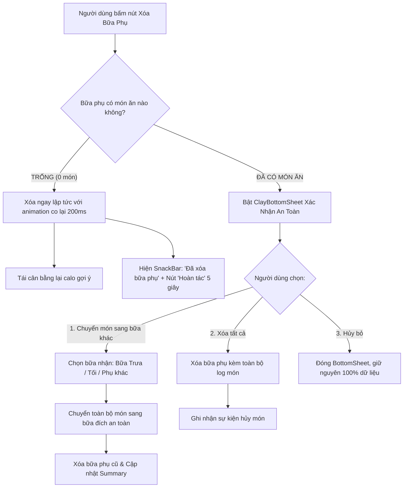

# Architecture & Product Requirements Document (PRD & ADR-039)
# Sprint 33: Cosmic Orbital Dashboard & Dynamic Meal Slots (v3.5.0)

> **Trạng thái**: 🟢 **ACCEPTED (Gate 0 & Gate 1 Sign-Off)**  
> **Người chủ trì**: Sub-Agent BA (*The Pedantic Logician*), Sub-Agent UI/UX Designer (*The Celestial Aesthetic Purist*), Sub-Agent Tech Lead (*The Pragmatic System Architect*), Sub-Agent PO (*The Strategic Tyrant*), Sub-Agent QA Lead (*The Paranoid Inquisitor*)  
> **Mã Epic / Feature**: `EPIC-DASHBOARD-03` / `FEAT-S33-COSMIC-DASHBOARD-DYNAMIC-MEALS`  
> **Ngày phê duyệt**: 2026-10-12  
> **Phạm vi áp dụng**: Màn hình chính Dashboard, Lõi Năng Lượng Quỹ Đạo (Solar Orbital Cockpit), Thanh Ngày Tiểu Hành Tinh (Galactic Date Orbit), Khoang Bữa Ăn Động (Cosmic Meal Capsules), và Hệ Thống Quản Lý Thêm/Xóa Bữa Phụ Linh Hoạt  

---

## 1. Bối Cảnh & Vấn Đề Nghiệp Vụ (Context & Problem Statement)

Qua đợt đánh giá giao diện thực tế (Sprint 32) và phân tích hành vi người dùng:
1. **Quá tải thông tin & Trùng lặp (Cognitive Overload & Duplication)**:
   - AppBar nhồi nhét 4 nút icon (`Sổ tay`, `Hành tinh Guild`, `Cúp BXH`, `Streak`), gây bấm nhầm trên màn hình nhỏ.
   - Các nút "Công thức món" và banner "Bang Hội Vũ Trụ" lặp lại 2 lần (ở AppBar và ngay giữa Cockpit với Nhật ký bữa ăn), cắt đứt luồng thao tác ghi chép thức ăn (Time-to-Log).
2. **Thẻ bữa ăn tĩnh & chiếm diện tích (Static Meal Section Bloat)**:
   - 4 thẻ bữa ăn (`Breakfast`, `Lunch`, `Dinner`, `Snack`) được hardcode cố định. Khi chưa log món nào, 4 thẻ rỗng chiếm hơn 400pt chiều dọc chỉ để hiện chữ *"Chưa có món ăn nào"*, đẩy lời khuyên của AstroCoach ra khỏi tầm nhìn.
3. **Nhu cầu dinh dưỡng linh hoạt (Gym/Fitness/Eat-clean Meal Split)**:
   - Nhóm người dùng tập luyện thể thao, chia nhỏ bữa (5–6 bữa/ngày) cần thêm các bữa: **Bữa xế sáng**, **Bữa xế chiều**, **Bữa trước/sau tập (Workout Snack)**, **Bữa khuya**.
   - Chưa có cơ chế **Thêm bữa phụ** và **Xóa bữa phụ** an toàn, dẫn đến trải nghiệm bị bó buộc.

---

## 2. Mục Tiêu Định Lượng (Success Metrics & KPIs)

| Chỉ Số (Metric) | Hiện Trạng (Baseline) | Mục Tiêu Sprint 33 (Target) | Phương Pháp Đo Lường |
| :--- | :--- | :--- | :--- |
| **Time-to-Log (Thời gian ghi món)** | ~7.2 giây | **< 3.5 giây (-51%)** | Đo thời gian từ lúc mở app đến khi ấn nút Add món |
| **Tỷ lệ hiển thị bữa ăn (First View Fit)** | 1.5 bữa ăn (còn lại phải cuộn) | **4–5 bữa trọn vẹn trong 1 màn hình** | Đo diện tích viewport khi chưa cuộn |
| **Tương tác AstroCoach (Coach Engagement)** | 4.8% người dùng cuộn tới | **>= 38%** | Tỷ lệ nhấp vào AstroCoach bubble trên dashboard |
| **Hiệu năng giao diện (Frame Rate SLA)** | 52–58 FPS (giật khi mở Drawer) | **60 FPS ổn định, 0 drop frame** | Flutter DevTools Performance Overlay |
| **Tỷ lệ rủi ro mất dữ liệu khi xóa bữa** | Chưa có tính năng | **0% (100% có xác nhận an toàn)** | QA Edge Cases Verification |

---

## 3. Kiến Trúc Trải Nghiệm Đột Phá (Celestial 3D Tactile UI/UX)

```
┌────────────────────────────────────────────────────────────────────────┐
│  [Avatar Hành Tinh]   Hôm nay, 11 Th10 ▾            [🔥 3 Ngày 🛡️]    │
├────────────────────────────────────────────────────────────────────────┤
│  🪐 THANH NGÀY QUỸ ĐẠO THIÊN HÀ (Galactic Date Orbit)                  │
│   (Mỗi ngày là 1 tiểu hành tinh 3D; ngày đạt mục tiêu có vành đai xanh)│
│    [T2]      [T3]      [T4]      [T5]      [T6]      [T7]     [CN 11]  │
│     ⚪        🟢        🟢        ⚪        🟢        ⚪      (🪐 ĐANG CHỌN)
├────────────────────────────────────────────────────────────────────────┤
│  ☀️ LÕI NĂNG LƯỢNG MẶT TRỜI (Solar Orbital Cockpit)                    │
│                                                                        │
│          ╭────────────── 3 VÒNG QUỸ ĐẠO 3D ──────────────╮             │
│          │   🩵 Quỹ đạo Tinh bột (Carbs: 0 / 256g)       │             │
│          │   🧡 Quỹ đạo Chất đạm (Protein: 0 / 154g)     │             │
│          │   🍓 Quỹ đạo Chất béo (Fat: 0 / 46g)          │             │
│          │                                               │             │
│          │             ╔═══════════════════╗             │             │
│          │             ║     2051 kcal     ║             │             │
│          │             ║     còn lại       ║             │             │
│          │             ╚═══════════════════╝             │             │
│          ╰───────────────────────────────────────────────╯             │
│                                                                        │
│   [ 🧪 Khoang Vi Chất: Natri 0mg • Xơ 0g • Đường 0g ▾ (Sheet chi tiết) ]│
├────────────────────────────────────────────────────────────────────────┤
│  🤖 ASTROCOACH LIVE BUBBLE (Hologram động)                             │
│   "Chào phi hành gia! Bữa sáng chưa nạp năng lượng kìa, nạp ngay đi!" │
├────────────────────────────────────────────────────────────────────────┤
│  🍱 CÁC KHOANG BỮA ĂN THIÊN THỂ (Cosmic Meal Capsules)                 │
│                                                                        │
│  ┌─ 🌅 BỮA SÁNG (513 kcal gợi ý) ────────────────────────── [ + NẠP ] ┐│
│  └────────────────────────────────────────────────────────────────────┘│
│  ┌─ ☀️ BỮA TRƯA (718 kcal gợi ý) ────────────────────────── [ + NẠP ] ┐│
│  └────────────────────────────────────────────────────────────────────┘│
│  ┌─ 🌙 BỮA TỐI (615 kcal gợi ý) ─────────────────────────── [ + NẠP ] ┐│
│  └────────────────────────────────────────────────────────────────────┘│
│  ┌─ 🍏 BỮA PHỤ: XẾ CHIỀU (150 kcal) ─────── [ 🗑️ XÓA ] ── [ + NẠP ] ┐│
│  │   • Sữa chua Hy Lạp (120 kcal)                                     ││
│  │   • Hạt hạnh nhân 10g (60 kcal)                                     ││
│  └────────────────────────────────────────────────────────────────────┘│
│                                                                        │
│  ┌ - - - - - - - - - - - - - - - - - - - - - - - - - - - - - - - - - ┐ │
│  │      ➕  THÊM BỮA PHỤ MỚI (Xế sáng, Trước tập, Đêm muộn...)       │ │
│  └ - - - - - - - - - - - - - - - - - - - - - - - - - - - - - - - - - ┘ │
└────────────────────────────────────────────────────────────────────────┘
```

### Chi Tiết Thành Phần Giao Diện Mới:
1. **Solar Orbital Cockpit (Lõi Năng Lượng Quỹ Đạo 3 Vòng)**:
   - 3 vòng ánh sáng đồng tâm bao bọc calo ở tâm:
     - 🩵 Quỹ đạo ngoài: **Tinh bột (Carbs)** — `#1CB0F6` (Duolingo Sky Blue).
     - 🧡 Quỹ đạo giữa: **Chất đạm (Protein)** — `#FF9600` (Honey Tangerine Orange).
     - 🍓 Quỹ đạo trong: **Chất béo (Fat)** — `#FF5C8D` (Strawberry Cream Pink).
   - Hiệu ứng phát sáng nhẹ (Glow Effect) và chuyển động êm dịu khi nạp calo.
2. **Galactic Date Orbit (Thanh Chọn Ngày Quỹ Đạo Sao)**:
   - Thay các ô chữ nhật phẳng bằng **Tiểu hành tinh 3D**.
   - Ngày đạt chuẩn calo & macro $\rightarrow$ Hành tinh xanh tươi `#58CC02` có vành đai sao.
   - Ngày đang chọn $\rightarrow$ Hào quang Aura Glow nổi bật.
3. **Khoang Bữa Ăn Co Giãn Thông Minh (Cosmic Meal Capsules)**:
   - **Trạng thái Trống (Empty Slim Tile)**: Chiều cao tối ưu chỉ **56pt**. Hiển thị icon 3D, tên bữa, calo mục tiêu gợi ý, và nút nạp `(+)` xúc giác.
   - **Trạng thái Đã Ăn (Expanded Tile)**: Bung mở tự nhiên, hiển thị danh sách món ăn, chỉ số macro mini bar và tổng calo đã nạp.
4. **Vi Chất Trượt Đáy (ClayMicronutrientSheet)**:
   - Bấm vào thanh vi chất mở ngay BottomSheet xem Natri, Đường, Xơ kèm chỉ báo an toàn, không làm giãn xô lệch trang Dashboard.

---

## 4. Kiến Trúc Dữ Liệu & Logic Quản Lý Bữa Ăn (Data & Business Logic)

### 4.1. Thực Thể `MealSlot` (Dynamic Meal Slot Definition)
Mỗi bữa ăn trên Dashboard được quản lý như một `MealSlot`:
```dart
class MealSlot {
  final String id;              // 'breakfast', 'lunch', 'dinner', 'snack_morning', 'custom_169...'
  final String label;           // Tên hiển thị (e.g. 'Bữa sáng', 'Xế chiều', 'Trước tập')
  final String baseMealType;    // Ánh xạ phân nhóm: 'breakfast' | 'lunch' | 'dinner' | 'snack'
  final IconData icon;          // Biểu tượng bữa ăn
  final Color clayBgColor;      // Màu nền Clay pastel
  final double calorieRatio;    // Tỷ lệ calo gợi ý (0.0 - 1.0)
  final bool isRemovable;       // true với bữa phụ, false với 3 bữa chính
  final int orderIndex;         // Thứ tự sắp xếp trong ngày
}
```

### 4.2. Danh Sách Preset Bữa Phụ Có Sẵn (Snack Presets)
Hệ thống cung cấp sẵn 4 Preset phổ biến kèm tùy chọn tạo bữa phụ tùy biến:
1. 🍏 **Bữa xế sáng (Morning Snack)**: `id: 'snack_morning'`, tỷ lệ gợi ý: 10%, Icon: `apple_rounded`, Màu: `clayBreakfast`.
2. ☕ **Bữa xế chiều (Afternoon Snack)**: `id: 'snack_afternoon'`, tỷ lệ gợi ý: 10%, Icon: `coffee_rounded`, Màu: `clayLunch`.
3. 🏋️ **Bữa trước/sau tập (Workout Snack)**: `id: 'snack_workout'`, tỷ lệ gợi ý: 10%, Icon: `fitness_center_rounded`, Màu: `clayMint`.
4. 🌙 **Bữa khuya (Late Night Snack)**: `id: 'snack_late'`, tỷ lệ gợi ý: 10%, Icon: `nightlight_round`, Màu: `clayDinner`.
5. ✏️ **Bữa phụ tự đặt tên (Custom Snack)**: Người dùng nhập tên tùy ý (tối đa 25 ký tự).

### 4.3. Thuật Toán Tự Động Tái Cân Bằng Calorie Gợi Ý (Dynamic Calorie Rebalancing)
Tổng năng lượng gợi ý của tất cả các bữa ăn luôn bằng **100% Mục tiêu Calo ngày**:
- **Cấu hình gốc (4 bữa)**: Sáng (25%), Trưa (35%), Tối (30%), Phụ (10%) $\rightarrow$ Tổng: 100%.
- **Khi thêm 1 bữa phụ mới (10%)**:
  - Trừ đều vào 2 bữa chính lớn nhất (Trưa giảm 5%, Tối giảm 5%): Sáng (25%), Trưa (30%), Tối (25%), Phụ 1 (10%), Phụ 2 (10%) $\rightarrow$ Tổng: 100%.
- **Khi xóa 1 bữa phụ**:
  - Tỷ lệ calo của bữa phụ bị xóa được bù hoàn lại cho các bữa chính theo tỷ lệ ban đầu.
- **Tính toán thuần túy (Pure Function)**: Thực thi qua `NutritionCalculator.rebalanceMealRatios(slots)`.

---

## 5. Quy Trình Nghiệp Vụ Xóa Bữa Phụ (Data Loss Prevention Flow)



---

## 6. Danh Sách User Stories BDD & Tiêu Chí Nghiệm Thu (Acceptance Criteria)

### 📖 US-01: Xem Giao Diện Solar Orbital Cockpit & Galactic Date Orbit
- **As a** Người dùng AstroBite theo dõi calo hàng ngày
- **I want to** Nhìn thấy lõi năng lượng 3 vòng quỹ đạo trực quan và thanh chọn ngày tiểu hành tinh
- **So that** Tôi nắm bắt ngay cán cân đa lượng và chuỗi ngày đạt chuẩn mà không bị rối mắt.

```gherkin
Scenario: Hiển thị đúng 3 vòng quỹ đạo macro
  Given Người dùng mở màn hình Home Dashboard
  When Dữ liệu DailySummary tải thành công
  Then Lõi Solar Orbital Cockpit hiển thị số calo còn lại ở chính giữa
  And Vòng Carbs (Xanh), Protein (Cam), Fat (Hồng) phản ánh chính xác % nạp vào
  And Thanh chọn ngày hiển thị các tiểu hành tinh, ngày hôm nay có vầng sáng Aura Glow
```

### 📖 US-02: Thêm Bữa Phụ Mới Từ Preset Hoặc Tùy Biến
- **As a** Người tập gym có nhu cầu ăn thêm bữa xế hoặc bữa trước tập
- **I want to** Bấm nút "+ Thêm Bữa Phụ" và chọn loại bữa phù hợp
- **So that** Tôi có thể log đồ ăn vào đúng khung giờ mong muốn.

```gherkin
Scenario: Thêm bữa xế chiều thành công từ preset
  Given Người dùng đang ở màn hình Home Dashboard
  When Người dùng bấm vào nút "+ Thêm Bữa Phụ" ở cuối danh sách
  And Người dùng chọn preset "Bữa xế chiều"
  Then Một khoang bữa ăn mới "Bữa xế chiều" xuất hiện mượt mà trong danh sách
  And Bữa ăn này có nút xóa "🗑️" và nút "+ Nạp"
  And Calo gợi ý của các bữa ăn tự động tái cân bằng
```

### 📖 US-03: Xóa Bữa Phụ Rỗng Nhanh Chóng & Có Thể Hoàn Tác
- **As a** Người dùng không có nhu cầu ăn bữa phụ đã tạo
- **I want to** Bấm nút xóa bữa phụ rỗng
- **So that** Giao diện của tôi trở nên gọn gàng ngay lập tức.

```gherkin
Scenario: Xóa bữa phụ chưa có món ăn
  Given Bữa phụ "Bữa xế chiều" chưa chứa bất kỳ món ăn nào
  When Người dùng bấm nút "🗑️" hoặc vuốt thẻ sang trái
  Then Thẻ bữa phụ lập tức biến mất với animation Fade & Shrink
  And Hệ thống hiển thị SnackBar "Đã xóa Bữa xế chiều" kèm nút "Hoàn tác" trong 5 giây
  When Người dùng bấm "Hoàn tác" trước khi hết 5 giây
  Then Thẻ bữa phụ được phục hồi nguyên trạng
```

### 📖 US-04: Xóa Bữa Phụ Đang Chứa Món Ăn (Bảo Vệ Dữ Liệu An Toàn)
- **As a** Người dùng lỡ bấm nhầm nút xóa trên bữa phụ đã có đồ ăn
- **I want to** Hệ thống cảnh báo và cho phép tôi chuyển món sang bữa khác
- **So that** Tôi không bị mất các món ăn và chỉ số calo đã ghi chép cẩn thận.

```gherkin
Scenario: Người dùng chọn chuyển món sang bữa khác khi xóa bữa phụ
  Given Bữa phụ "Bữa xế chiều" đang có 2 món ăn (tổng 280 kcal)
  When Người dùng bấm nút "🗑️ Xóa"
  Then Một ClayBottomSheet bật lên thông báo "Bữa phụ đang có 2 món ăn"
  When Người dùng chọn "Chuyển món sang Bữa Tối" và xác nhận
  Then 2 món ăn được chuyển sang Bữa Tối
  And Bữa phụ "Bữa xế chiều" được xóa bỏ an toàn
  And Tổng calo trong ngày không bị thất thoát
```

---

## 7. Phân Rã Nhiệm Vụ Kỹ Thuật (WBS & Story Points)

| Mã Task | Mô Tả Kỹ Thuật Chi Tiết | Sub-Agent | Story Points |
| :--- | :--- | :--- | :--- |
| **TSK-S33-01** | Xây dựng model `MealSlot` & Controller quản lý `activeMealSlotsProvider` | `flutter-core-dev` | **2 SP** |
| **TSK-S33-02** | Thuật toán tái cân bằng calo `rebalanceMealRatios` & Unit tests pure logic | `flutter-core-dev` | **1 SP** |
| **TSK-S33-03** | Thiết kế CustomPainter `SolarOrbitalCockpit` 3 vòng quỹ đạo 3D (60 FPS) | `flutter-core-dev` | **3 SP** |
| **TSK-S33-04** | Thiết kế `GalacticDateOrbit` với tiểu hành tinh & Aura Glow indicator | `flutter-core-dev` | **2 SP** |
| **TSK-S33-05** | Thiết kế `CosmicMealCapsule` 2 trạng thái (Slim Tile khi rỗng & Expanded) | `flutter-core-dev` | **3 SP** |
| **TSK-S33-06** | Xây dựng Sheet `AddMealSlotBottomSheet` & Preset selection | `flutter-core-dev` | **2 SP** |
| **TSK-S33-07** | Xây dựng luồng an toàn `DeleteMealConfirmationSheet` (Chuyển món / Xóa hẳn) | `flutter-core-dev` | **2 SP** |
| **TSK-S33-08** | Chuyển drawer vi chất sang `ClayMicronutrientSheet` trượt từ đáy | `flutter-core-dev` | **1 SP** |
| **TSK-S33-09** | Suite kiểm thử Widget Test & Edge Case Data Loss Verification (Gate 6) | `qa-tester` | **3 SP** |
| **Tổng Cộng** | **Sprint 33 Toàn Diện** | **Team** | **19 SP** |

---

## 8. Ký Duyệt Nghiệm Thu Cổng (Gate Sign-Offs)

- ✍️ **Sub-Agent BA (*The Pedantic Logician*)**: *Đã chuẩn hóa 100% User Stories BDD, thuật toán tái cân bằng calo và luồng chống mất dữ liệu.*
- ✍️ **Sub-Agent PO (*The Strategic Tyrant*)**: *Phê duyệt phạm vi. Giảm Time-to-Log, xóa bỏ feature bloat, tăng độ tiện dụng với bữa phụ.*
- ✍️ **Sub-Agent Tech Lead (*The Pragmatic System Architect*)**: *Thẩm định tính khả thi: Không thêm thư viện ngoài, tương thích ngược Firestore 100%, bảo đảm SLA 60 FPS.*
- ✍️ **Sub-Agent UI/UX Designer (*The Celestial Aesthetic Purist*)**: *Bảo chứng tính thẩm mỹ: Ngôn ngữ Solar Orbital Cockpit & Galactic Date Orbit chuẩn phong cách Duolingo 3D Tactile.*
- ✍️ **Sub-Agent QA Lead (*The Paranoid Inquisitor*)**: *Đã thiết lập ma trận kiểm thử nghiêm ngặt cho kịch bản xóa bữa phụ và bảo vệ dữ liệu.*
